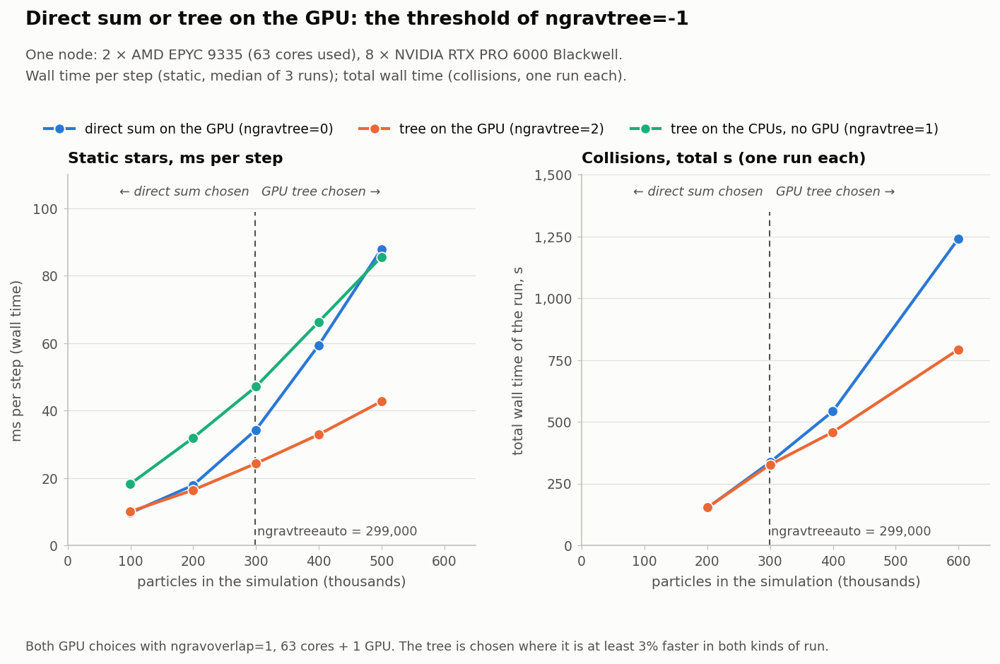

Performance
===========

All the gains reported for this code were measured on one kind of node (an NVIDIA RTX PRO 6000 Blackwell GPU, or eight, with two AMD EPYC 9335 processors) and can be much smaller on other hardware.  The tables of those measurements are on a dated page, :doc:`benchmarks_2026_11`.  This page keeps what is meant to stay true when the code changes: which settings to choose, what they do to the conservation laws, and what has not been measured.

.. contents::
   :local:
   :depth: 1

Which settings to choose
------------------------

The defaults are ``OPENMP=0`` in the build (the plain MPI build), ``ngravtree = 0`` (the direct sum) and ``ngravoverlap = -1`` (chosen by the code).

* **OpenMP or not.** ``make OPENMP=1`` builds the hybrid MPI x OpenMP code (see :doc:`installation`).  With one thread it gives the same bits as the plain build and is not faster, so the gain comes only from threads.  Threads help only where the loops are threaded: the SPH loops and the tree gravity on the CPUs.  The direct sum on the CPUs is not threaded.
* **Threads or ranks.** With the direct sum on the CPUs, many ranks are faster than many threads, so keep the plain build and use one rank per core (at most ``ngravprocsmax`` = 32 ranks compute the gravity).  With the tree on the CPUs (``ngravtree = 1``), use the OpenMP build with one rank that has all the cores (or one per socket): every rank builds the whole tree, so more ranks repeat the work.  With a GPU, use one rank with all the cores, or one rank per GPU with the cores next to it; on the UPSCALE node this was faster than one rank per core in every case measured, but one rank of many threads against many ranks that share a GPU has not been measured elsewhere.
* **OMP_NUM_THREADS.** If it is set, the code uses it.  If it is not set, a run with several ranks uses one thread per rank, and a run with a single rank uses one thread per logical CPU, that is the whole node.  Set it, and pin the threads, when several runs share a node.
* **ngravtree.** The default ``0`` is the direct sum, on the GPUs if there are any.  ``1`` is the tree on the CPUs, ``2`` the same tree walked on the GPUs (it needs a CUDA build and ``nleafgrav`` of at most 32).  ``-1`` chooses once from the number of particles: the tree on the CPUs without a GPU, the direct sum on a GPU below ``ngravtreeauto`` particles and the tree walked on the GPU from there up (see `The threshold of ngravtree = -1`_).  The tree pays when there are many particles and few GPUs or none.  It does not conserve momentum exactly (see `Accuracy and conservation`_).
* **ngravoverlap.** The GPUs work while the CPUs solve the smoothing lengths.  ``-1`` switches it on for the direct sum on one GPU and for the tree on the GPUs, and off for the direct sum on several GPUs, for the tree on the CPUs and where there is no CUDA library.  On the UPSCALE node it helped most for the direct sum on one GPU, and cost a few percent for the direct sum on several GPUs.  The details are in :doc:`using/gravity`.
* **Several GPUs.** With the direct sum, ``ngravprocs`` (one process per GPU) or ``ngpuperrank`` (several GPUs for one process) use them.  With the tree walked on the GPU one GPU was enough on the UPSCALE node, and the other GPUs are free for other runs.

Accuracy and conservation
-------------------------

The direct sum on the GPUs conserves the total momentum and angular momentum to the rounding of the force sums.  The tree, on the CPUs or on the GPUs, conserves them only to the error of the tree.  With ``treeacc = 0.45`` and ``nleafgrav = 24`` the rms error of the force relative to the direct sum in double precision was 9.8e-4 for a relaxed Sun of 99954 particles and 5.1e-4 for the Sun with each particle divided into 5.  In a collision of two such Suns followed to t = 30, the largest relative change of the total energy was 5.4e-5 with the direct sum and 3.7e-5 with the tree on the GPUs, but the change of the total momentum, in units of the dynamical scale, was 1.4e-9 with the direct sum and 2.5e-5 with the tree.  Use the direct sum where the momentum and angular momentum must stay exact, and a smaller ``treeacc`` for a more accurate tree.  ``ngravoverlap = 1`` with the direct sum changes the force sums in the last digits (the energy is conserved as well); with the tree on the GPUs it gives the same bits as ``0``.  The full table is on :doc:`benchmarks_2026_11`.

The threshold of ngravtree = -1
-------------------------------

   The direct sum and the tree on the GPU (both with ``ngravoverlap = 1``) and the tree on the CPUs against the number of particles, with the threshold ``ngravtreeauto``.

The time per step of the direct sum on one GPU and of the tree walked on it was measured for static models of 1e5 to 5e5 particles and for collisions of 2e5 to 6e5 particles in total (both stars counted).  The threshold is the smallest number of particles for which the tree was at least 3% faster, taken for the static runs (199908) and for the collisions (299862), and then the higher of the two, rounded to a simple value: ``ngravtreeauto = 299000``.  In the static runs the tree was 4% slower at 99954 particles, 8% faster at 199908 and about twice as fast at 499770; in the collisions it was 1% slower at 199908 and 3% faster at 299862.

This is a value for one GPU type and one CPU type, and other machines will want their own.  On a GPU of the class of an A30, for example, the tree on the GPU gains nothing at 1e5 particles.  Set ``ngravtreeauto`` in ``sph.input``, or choose ``ngravtree`` by hand, after timing a few steps of your own model with ``ngravtree = 0`` and ``2``.

What was not measured
---------------------

* Other hardware: other GPUs, other CPUs, nodes with more than 64 cores.  The threshold of ``ngravtree = -1`` and the choice of the overlap were measured on one node only.
* Many ranks that share one GPU against one rank with many threads, on nodes other than the one above.
* More than one node (MPI over the network), and more than 2M particles.
* macOS and Apple Silicon (Metal), and compilers other than gfortran with OpenMPI.
* Block time steps (``nblock = 1``): the tables use ``nblock = 0``, and the energy drift with block steps is larger.
* Periodic boxes, and the other equations of state and initial conditions of the code.
* The times of ``master`` come from an earlier measurement on a node of the same type, not from the same chain, except for two cases that were measured again.
