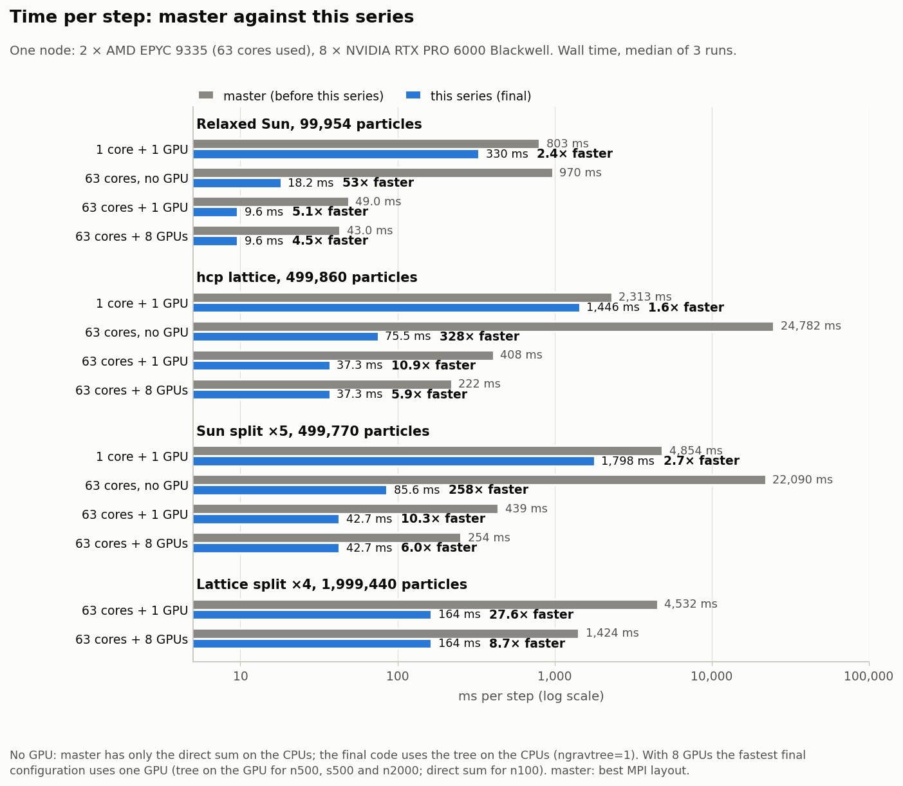
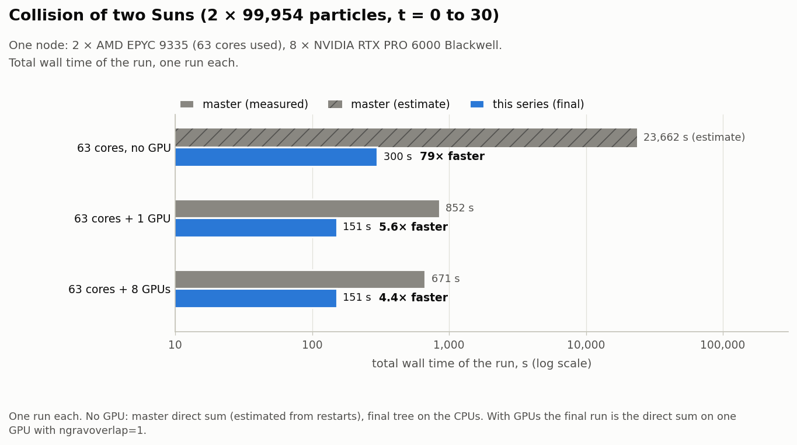
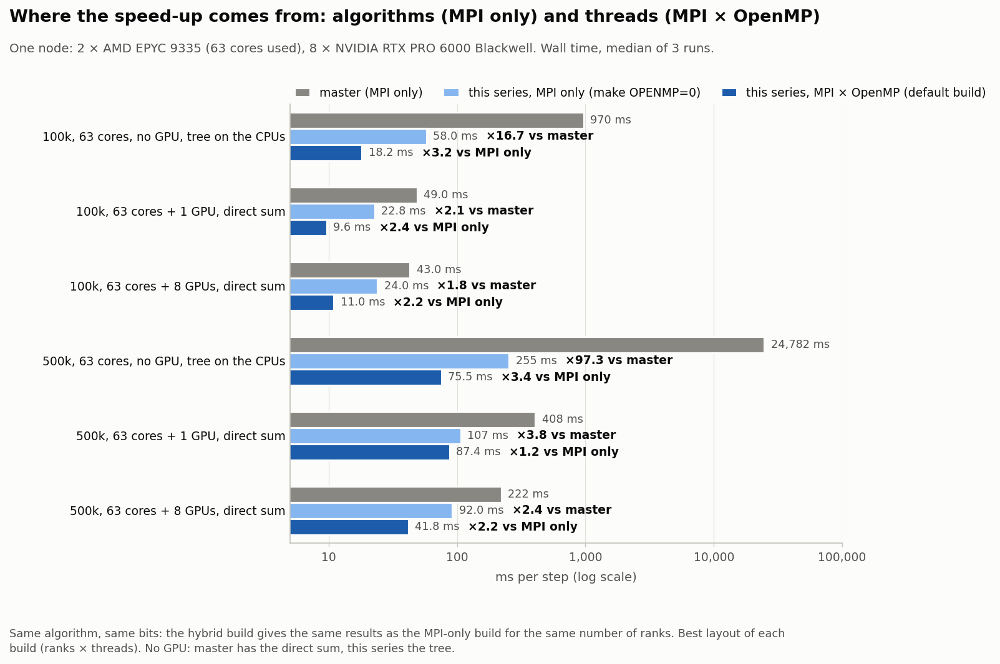
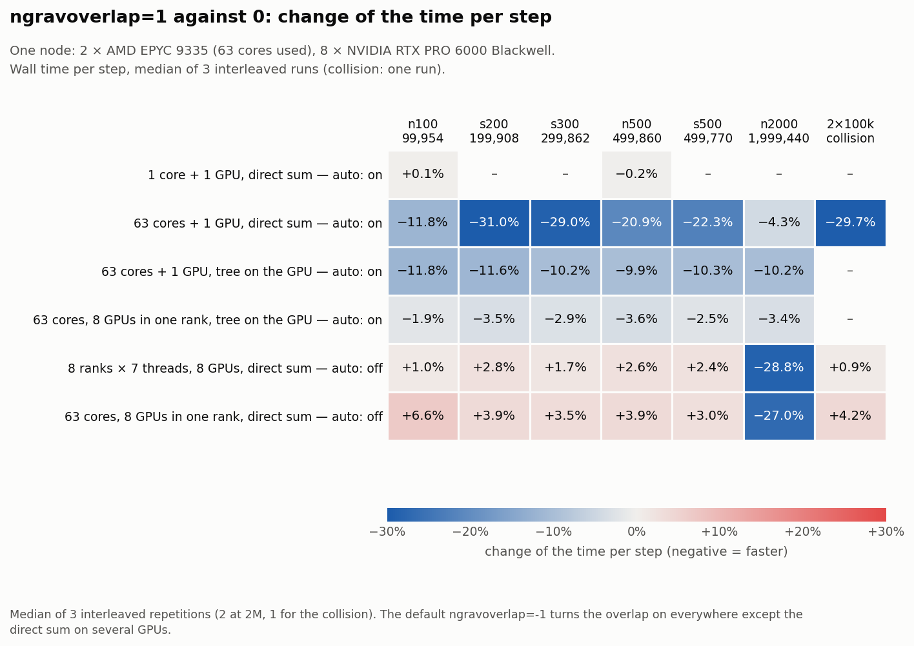
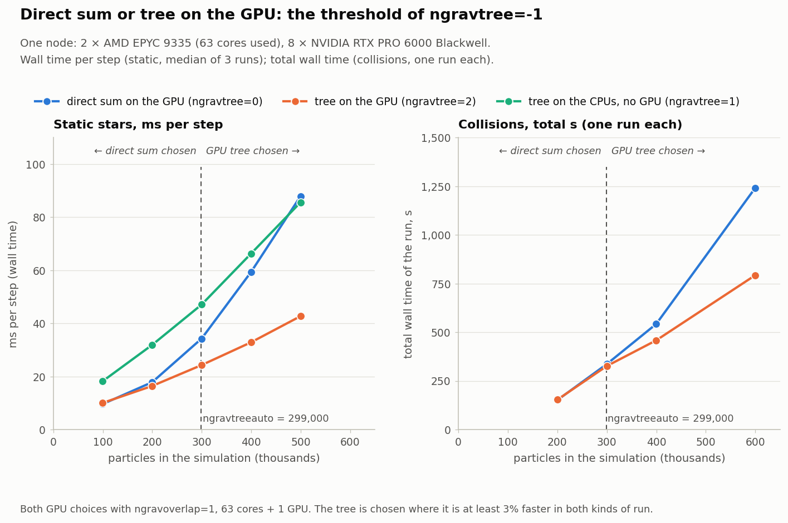
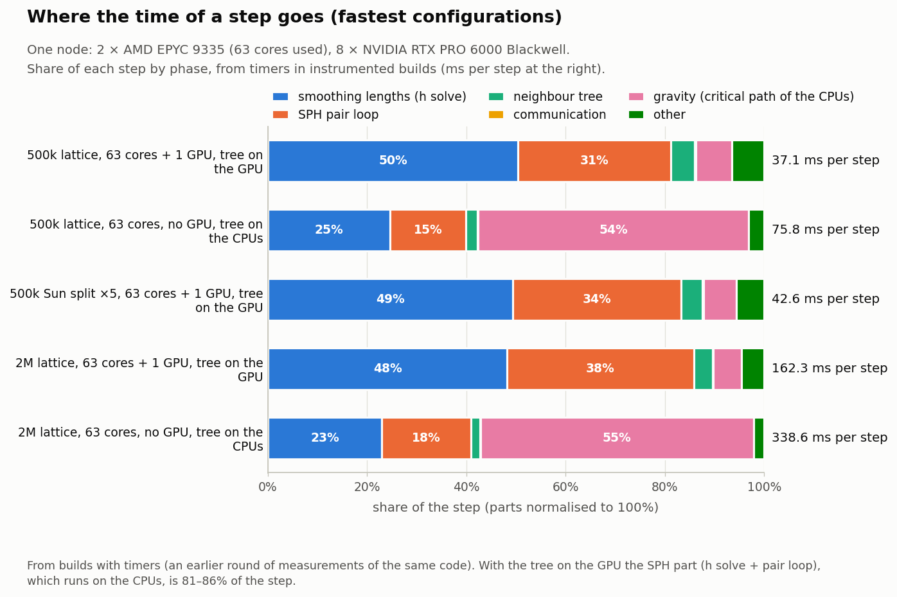

Performance
===========

This page says how long a step of StarSmasher takes on one kind of machine with the settings of this version, how that compares with ``master`` before the series of speed-ups, and which settings to choose. Every number comes from measurements of the final code on the machine described below; on other hardware the numbers, and some of the choices, will differ (see `What was not measured`_).

.. contents::
   :local:
   :depth: 1

Machine and method
------------------

* **Machine.** One GPU node of the UPSCALE cluster: two AMD EPYC 9335 (32 cores each, 63 usable by a job), about 1.5 TB of memory, eight NVIDIA RTX PRO 6000 Blackwell GPUs. gfortran 14.2, OpenMPI 5.0, CUDA 13.1, ``make gpu`` or ``make cpu`` with ``OPENMP=1`` and the default flags.
* **Models.** The relaxed Sun of 99954 particles (n100); a sphere of uniform density on an hcp lattice of 499860 particles (n500); the Sun with every particle divided into 5 (499770 particles, s500) and into 2, 3 and 4 (s200, s300, s400: 199908, 299862, 399816); the lattice with every particle divided into 4 (1999440, n2000, for timing only: it is not relaxed). Collisions: two relaxed Suns on a parabolic orbit with pericentre 1 R_sun, followed to t = 30 with ``nblock = 0``, and two stars of 499770 particles on the same orbit.
* **The time of a step** is the wall time between the end-of-step lines of the log, the median over the steps after the first few (which are skipped), and then the median over the repetitions of a configuration (3, 2 at 2M particles). The runs of the configurations that are compared were interleaved in one chain on one node. Complete collisions are single runs, and the time is the wall time of the whole run.
* **The previous code.** The times of ``master`` are those measured earlier on a node of the same type, with the layout that was best for it (one rank per core, ``-np`` 32 to 63), not measured again for this page, except for the two cases that say so.

The configurations, with the input that makes them (the settings not listed are the defaults):

.. list-table::
   :header-rows: 1
   :widths: 8 30 18 40

   * - name
     - layout
     - gravity
     - input
   * - S
     - 1 rank x 1 thread, 1 GPU
     - direct sum
     - 
   * - H0
     - 1 rank x 63 threads, no GPU (``make cpu``)
     - tree on the CPUs
     - ``ngravtree=1``
   * - H1
     - 1 rank x 63 threads, 1 GPU
     - direct sum
     - ``ngravoverlap=1`` (the default for this case)
   * - H8
     - 8 ranks x 7 threads, 8 GPUs
     - direct sum
     - ``ngravprocs=8``
   * - B1
     - 1 rank x 63 threads, 8 GPUs
     - direct sum
     - ``ngpuperrank=8``
   * - H1T
     - 1 rank x 63 threads, 1 GPU
     - tree on the GPU
     - ``ngravtree=2``
   * - B1T
     - 1 rank x 63 threads, 8 GPUs
     - tree on the GPU
     - ``ngravtree=2 ngpuperrank=8``

``OPENMP=1``, ``OMP_NUM_THREADS`` equal to the threads of the table, ``OMP_PLACES=cores`` and ``OMP_PROC_BIND=close``; ``treeacc = 0.45`` and ``nleafgrav = 24`` for the trees. ``ngravoverlap`` is left at its default in H1, H1T, B1T and S (1) and in H8 and B1 (0); see below.

Time per step, ``master`` against the final code
---------------------------------------------------

The final code is between 1.6 and 328.1 times faster than ``master`` on the cases that ``master`` was measured on (the ratio is the time of ``master`` divided by the time of the fastest configuration of the final code that was measured for that hardware). Times are milliseconds per step. The very large ratios without a GPU are the tree on the CPUs against the direct sum on the CPUs that ``master`` has; with the same direct sum the gains come from the kernel tables, the neighbour search, the GPU kernel and the threads.

   Time per step of ``master`` and of the fastest configuration of the final code for each model and hardware (log scale), with the ratio.

**relaxed Sun (99954 particles)**

.. list-table::
   :header-rows: 1
   :widths: 14 9 9 7 40 30

   * - hardware
     - master
     - final
     - ratio
     - fastest final configuration
     - the others (ms)
   * - 1 core, 1 GPU
     - 803.0
     - 329.95
     - 2.43
     - S_ov1 (1x1): ``ngravoverlap=1``
     - 
   * - 63 cores, no GPU
     - 970.5
     - 18.16
     - 53.44
     - H0 (1x63): ``ngravtree=1 treeacc=0.45 nleafgrav=24``
     - 
   * - 63 cores, 1 GPU
     - 49.0
     - 9.63
     - 5.09
     - H1_ov1 (1x63): ``ngravoverlap=1``
     - H1T_ov1 10.09
   * - 63 cores, 8 GPUs
     - 43.0
     - 9.63
     - 4.46
     - H1_ov1 (one of the 8 GPUs) (1x63): ``ngravoverlap=1``
     - H1T_ov1 (one of the 8 GPUs) 10.09; B1T_ov1 10.84; H8 10.96; B1 11.84

**hcp lattice sphere (499860)**

.. list-table::
   :header-rows: 1
   :widths: 14 9 9 7 40 30

   * - hardware
     - master
     - final
     - ratio
     - fastest final configuration
     - the others (ms)
   * - 1 core, 1 GPU
     - 2313.0
     - 1445.85
     - 1.60
     - S_ov1 (1x1): ``ngravoverlap=1``
     - 
   * - 63 cores, no GPU
     - 24782.0
     - 75.53
     - 328.12
     - H0 (1x63): ``ngravtree=1 treeacc=0.45 nleafgrav=24``
     - 
   * - 63 cores, 1 GPU
     - 407.5
     - 37.28
     - 10.93
     - H1T_ov1 (1x63): ``ngravtree=2 treeacc=0.45 nleafgrav=24 ngravoverlap=1``
     - H1_ov1 87.37
   * - 63 cores, 8 GPUs
     - 221.5
     - 37.28
     - 5.94
     - H1T_ov1 (one of the 8 GPUs) (1x63): ``ngravtree=2 treeacc=0.45 nleafgrav=24 ngravoverlap=1``
     - B1T_ov1 38.62; B1 41.33; H8 41.77; H1_ov1 (one of the 8 GPUs) 87.37

**Sun divided by 5 (499770)**

.. list-table::
   :header-rows: 1
   :widths: 14 9 9 7 40 30

   * - hardware
     - master
     - final
     - ratio
     - fastest final configuration
     - the others (ms)
   * - 1 core, 1 GPU
     - 4854.0
     - 1798.15
     - 2.70
     - S_ov1 (1x1): ``ngravoverlap=1``
     - 
   * - 63 cores, no GPU
     - 22089.5
     - 85.62
     - 257.98
     - H0 (1x63): ``ngravtree=1 treeacc=0.45 nleafgrav=24``
     - 
   * - 63 cores, 1 GPU
     - 439.0
     - 42.68
     - 10.29
     - H1T_ov1 (1x63): ``ngravtree=2 treeacc=0.45 nleafgrav=24 ngravoverlap=1``
     - H1_ov1 87.86
   * - 63 cores, 8 GPUs
     - 254.0
     - 42.68
     - 5.95
     - H1T_ov1 (one of the 8 GPUs) (1x63): ``ngravtree=2 treeacc=0.45 nleafgrav=24 ngravoverlap=1``
     - B1T_ov1 43.86; B1 46.00; H8 50.95; H1_ov1 (one of the 8 GPUs) 87.86

**lattice sphere divided by 4 (1999440)**

.. list-table::
   :header-rows: 1
   :widths: 14 9 9 7 40 30

   * - hardware
     - master
     - final
     - ratio
     - fastest final configuration
     - the others (ms)
   * - 63 cores, no GPU
     - not measured
     - 342.36
     - 
     - H0 (1x63): ``ngravtree=1 treeacc=0.45 nleafgrav=24``
     - 
   * - 63 cores, 1 GPU
     - 4532.5
     - 164.20
     - 27.60
     - H1T_ov1 (1x63): ``ngravtree=2 treeacc=0.45 nleafgrav=24 ngravoverlap=1``
     - H1_ov1 1343.37
   * - 63 cores, 8 GPUs
     - 1424.0
     - 164.20
     - 8.67
     - H1T_ov1 (one of the 8 GPUs) (1x63): ``ngravtree=2 treeacc=0.45 nleafgrav=24 ngravoverlap=1``
     - B1T_ov1 166.02; B1 277.72; H8 317.04; H1_ov1 (one of the 8 GPUs) 1343.37

``master`` measured again, in the same chain and on the same node as the final code (hcp lattice of 499860 particles; ``master``: 32 ranks of one thread, four ranks per core complex):

.. list-table::
   :header-rows: 1
   :widths: 20 15 15 10

   * - hardware
     - master (ms)
     - final (ms)
     - ratio
   * - 63 cores, 1 GPU
     - 407.10
     - 87.37
     - 4.66
   * - 63 cores, 8 GPUs
     - 222.39
     - 41.77
     - 5.32

Collisions
----------

Total time of the run in seconds (wall time, ``nblock = 0``, t = 0 to 30). Where it says *estimate* the time is not a measurement: it is the number of steps of a complete run times the time per step of the 100-step restarts from the dumps t = 0, 5, ... 30 of that run (nearest in t); the ``master`` time for the two Suns on the CPUs is likewise an estimate. There is no ``master`` measurement for the two stars of 500k.

   Total time of the collision of two Suns (t = 0 to 30, ``nblock = 0``), ``master`` against the final code.

.. list-table::
   :header-rows: 1
   :widths: 28 14 10 12 7 40

   * - case
     - hardware
     - master (s)
     - final (s)
     - ratio
     - fastest final configuration
   * - two Suns (99954 particles each)
     - 63 cores, no GPU
     - 23662.0
     - 299.6
     - 78.98
     - H0: ``ngravtree=1 treeacc=0.45 nleafgrav=24``
   * - two Suns (99954 particles each)
     - 63 cores, 1 GPU
     - 852.5
     - 151.0
     - 5.64
     - H1_ov1: ``ngravoverlap=1``
   * - two Suns (99954 particles each)
     - 63 cores, 8 GPUs
     - 671.1
     - 151.0
     - 4.44
     - H1_ov1: ``ngravoverlap=1 (one of the 8 GPUs)``
   * - two stars of 499770 particles each
     - 63 cores, no GPU
     - not measured
     - 3271.0 (estimate)
     - 
     - H0: ``ngravtree=1 treeacc=0.45 nleafgrav=24``
   * - two stars of 499770 particles each
     - 63 cores, 1 GPU
     - not measured
     - 1462.9
     - 
     - H1T_ov1: ``ngravtree=2 treeacc=0.45 nleafgrav=24 ngravoverlap=1``
   * - two stars of 499770 particles each
     - 63 cores, 8 GPUs
     - not measured
     - 1462.9
     - 
     - H1T_ov1: ``ngravtree=2 treeacc=0.45 nleafgrav=24 ngravoverlap=1 (one of the 8 GPUs)``

OpenMP and MPI only
--------------------

The final code was also run MPI only (``make OPENMP=0``, ranks x threads = 63x1, 32x1, 16x1, 8x1; the best layout of each case is the one shown) to separate what comes from the algorithms and the kernels from what comes from the threads. Wall time per step in ms; ``master`` is its best MPI layout from the earlier measurements; the hybrid column is the fastest configuration of the tables above. The direct sum on the CPUs does not start with 63 ranks (``ngravprocsmax`` is 32), so its layouts are 32x1 and fewer; the hybrid code was not run with the direct sum on the CPUs.

   ``master``, the final code built MPI only (``make OPENMP=0``) and the hybrid MPI x OpenMP build: the first factor is the algorithms, the second the threads.

.. list-table::
   :header-rows: 1
   :widths: 8 14 18 9 16 10 10 10 10

   * - model
     - hardware
     - algorithm
     - master
     - final, MPI only (ranks x threads)
     - final, hybrid
     - master / MPI only
     - MPI only / hybrid
     - master / hybrid
   * - n100
     - 63 cores, no GPU
     - direct sum
     - 970.5
     - 827.9 (32x1)
     - not measured
     - 1.17
     - 
     - 
   * - n100
     - 63 cores, no GPU
     - tree on the CPUs (``ngravtree=1``)
     - 970.5
     - 58.0 (32x1)
     - 18.2
     - 16.74
     - 3.19
     - 53.44
   * - n100
     - 63 cores, 1 GPU
     - direct sum
     - 49.0
     - 22.8 (63x1)
     - 9.6
     - 2.15
     - 2.37
     - 5.09
   * - n100
     - 63 cores, 8 GPUs
     - direct sum
     - 43.0
     - 24.0 (63x1)
     - 11.0
     - 1.79
     - 2.19
     - 3.92
   * - n500
     - 63 cores, no GPU
     - direct sum
     - 24782.0
     - 23480.9 (32x1)
     - not measured
     - 1.06
     - 
     - 
   * - n500
     - 63 cores, no GPU
     - tree on the CPUs (``ngravtree=1``)
     - 24782.0
     - 254.8 (32x1)
     - 75.5
     - 97.25
     - 3.37
     - 328.12
   * - n500
     - 63 cores, 1 GPU
     - direct sum
     - 407.5
     - 106.9 (32x1)
     - 87.4
     - 3.81
     - 1.22
     - 4.66
   * - n500
     - 63 cores, 8 GPUs
     - direct sum
     - 221.5
     - 92.0 (32x1)
     - 41.8
     - 2.41
     - 2.20
     - 5.30

With the same algorithm the hybrid build is 1.2 to 3.4 times faster than the MPI-only build of the same code; the rest of the gain over ``master`` is the algorithms (the tree, the neighbour search, the kernel tables, the GPU kernel). The results of the two builds have the same bits for the same number of ranks.

Which settings to choose
------------------------

The rules below follow from the tables above and from the measurements behind :doc:`using/gravity`; the defaults of the input that changed are ``ngravoverlap`` (``-1``: chosen by the code) and, in the build, ``OPENMP`` (now 1: hybrid MPI x OpenMP); ``ngravtree`` stays 0 unless the input says otherwise.

* **Without a GPU** (``make cpu``): ``ngravtree = 1`` with the OpenMP build and one rank with all the cores.
* **With GPUs**: ``ngravtree = -1`` chooses the direct sum below ``ngravtreeauto = 299000`` particles and the tree walked on the GPUs from there up, which is what the measurements below say. Below the threshold the direct sum on one GPU is the fastest, above it the tree is faster, by more the larger the system (2M particles: see the tables).
* **The number of GPUs.** With the tree walked on the GPU, one GPU is enough: for the lattice of 499860 particles one rank with one GPU (H1T) takes 37.3 ms and with eight (B1T) 38.6 ms, and at 2M 164 against 166 ms, so the other seven GPUs are free for other work. The direct sum is the case that uses several GPUs well: 87 ms with one GPU (H1), 42 ms with eight processes of one GPU each (H8) and 41 ms with one process for the eight (B1) at 500k; at that size the tree on one GPU is still faster than the direct sum on eight. The tree makes every process build the whole tree, so give it one process with all the cores (``-np 1``, the OpenMP build).
* **``ngravoverlap``.** The GPUs work while the CPUs solve the smoothing lengths. The default (``-1``) takes it where it was measured to help: the direct sum on one GPU and the tree on the GPUs; the direct sum on several GPUs does not use it (it costs 1% to 7% for 100k to 500k particles). The table of the cells is in the next section.
* **MPI only or hybrid.** The default build is hybrid (``OPENMP = 1``): fewer ranks, each with several threads. With the same algorithm it is faster than the MPI-only build (``OPENMP=0``, one rank per core) in every case that was measured, by the factors of the table in the section `OpenMP and MPI only`_, and the bits of the results are the same as those of ``OPENMP=0`` with the same number of ranks. ``make OPENMP=0`` goes back to MPI only.
* **``MARCH=native``.** Not used for the tables. In an earlier round (not repeated for this page) it shortened the step without a GPU by about 9% at 500k (the walk of the tree and the pair loop) and by less than 1% with GPUs; it changes the bits of the results. It is worth trying for runs without GPUs only.
* **Where the tree is not good enough.** The tree on the CPUs or the GPUs does not conserve the total momentum and angular momentum to machine precision (see `Accuracy and conservation`_). Use the direct sum for runs that need that, and accept the cost.

The overlap of the GPUs with the CPU work
-------------------------------------------

   Change of the time per step with ``ngravoverlap = 1`` against ``0`` for each configuration and model, and what the default ``-1`` chooses.

Change of the time per step with ``ngravoverlap = 1`` against ``0`` (negative: shorter), median of 3 interleaved repetitions (2 at 2M):

.. list-table::
   :header-rows: 1
   :widths: 10 9 9 9 9 9 9

   * - model
     - S
     - H1
     - H8
     - B1
     - H1T
     - B1T
   * - n100
     - +0.1%
     - -11.8%
     - +1.0%
     - +6.6%
     - -11.8%
     - -1.9%
   * - s200
     - 
     - -31.0%
     - +2.8%
     - +3.9%
     - -11.6%
     - -3.5%
   * - s300
     - 
     - -29.0%
     - +1.7%
     - +3.5%
     - -10.2%
     - -2.9%
   * - n500
     - -0.2%
     - -20.9%
     - +2.6%
     - +3.9%
     - -9.9%
     - -3.6%
   * - s500
     - 
     - -22.3%
     - +2.4%
     - +3.0%
     - -10.3%
     - -2.5%
   * - n2000
     - 
     - -4.3%
     - -28.8%
     - -27.0%
     - -10.2%
     - -3.4%

Collision of two Suns (one run each, wall time of the run): B1 +4.2%, H1 -29.7%, H8 +0.9%.

The cells that get worse are H8 and B1 for 100k to 500k particles; at 2M they get much better (the table), but there the tree is the better solver and the code does not use the overlap for the direct sum on several GPUs, because a rule that depended on N would need a threshold that was not measured between 500k and 2M.

The threshold of ``ngravtree = -1``
-----------------------------------

   The direct sum and the tree on the GPU (both with ``ngravoverlap = 1``) and the tree on the CPUs against the number of particles, with the threshold ``ngravtreeauto``.

Time of the direct sum (H1) and of the tree on the GPU (H1T), both with the overlap, as a function of the number of particles N of the whole simulation (a collision counts both stars); the gain is ``1 - t_tree / t_direct``:

.. list-table::
   :header-rows: 1
   :widths: 10 12 10 10 10 20 12

   * - kind
     - model
     - N
     - H1
     - H1T
     - unit
     - gain of the tree
   * - static
     - n100
     - 99954
     - 9.61
     - 10.03
     - ms per step (wall)
     - -4.3%
   * - static
     - s200
     - 199908
     - 17.82
     - 16.41
     - ms per step (wall)
     - 7.9%
   * - static
     - s300
     - 299862
     - 34.26
     - 24.28
     - ms per step (wall)
     - 29.1%
   * - static
     - s400
     - 399816
     - 59.34
     - 32.85
     - ms per step (wall)
     - 44.6%
   * - static
     - s500
     - 499770
     - 87.87
     - 42.69
     - ms per step (wall)
     - 51.4%
   * - collision
     - solar
     - 199908
     - 151.0
     - 153.0
     - s in total (wall)
     - -1.0%
   * - collision
     - s100ps200
     - 299862
     - 336.0
     - 326.0
     - s in total (wall)
     - 3.1%
   * - collision
     - s200
     - 399816
     - 542.0
     - 458.0
     - s in total (wall)
     - 15.5%
   * - collision
     - s300
     - 599724
     - 1240.0
     - 792.0
     - s in total (wall)
     - 36.1%

* static runs: 199908 (the smallest N with a gain of at least 3%).
* collisions: 299862 (the smallest N with a gain of at least 3%).
* the higher of the two: 299862.

The threshold is the higher of the two thresholds, rounded to a simple value: ``ngravtreeauto = 299000``. It was measured on this node (63 cores, Blackwell GPUs); on other hardware the best value may be different.

Accuracy and conservation
-------------------------

* **Force.** The direct sum on the GPUs (float arithmetic with a double-single sum) differs from the sum in double precision by an rms of 2.8e-7 of the force scale (maximum 5.6e-6) for the Sun of 99954 particles. The tree with ``treeacc = 0.45`` and ``nleafgrav = 24`` has an rms error of 9.8e-4 (99th percentile 3.1e-3) for the Sun and 5.1e-4 (1.8e-3) for the Sun divided by 5, relative to the direct sum in double precision. These figures were measured with the standalone force test on the code of the previous round; the final code gives the same bits for the first step of every case that was compared (``results/verifiche.csv``), so they are the force errors of the final code too. A smaller ``treeacc`` is slower and more accurate.
* **Collisions** (t = 0 to 30; dE is the largest relative change of the total energy from the fifth line of ``energy0.sph`` on, because the first lines of the stars of 500k hold a transient of the start that is the same in every configuration, the direct sum included; dP and dL are the change of the total momentum and angular momentum in units of the dynamical scale):

.. list-table::
   :header-rows: 1
   :widths: 10 16 10 12 12 12

   * - model
     - configuration
     - time (s)
     - dE
     - dP
     - dL
   * - two Suns
     - B1
     - 166.9
     - 5.257e-05
     - 1.721e-09
     - 8.140e-09
   * - two Suns
     - H0
     - 299.6
     - 3.141e-05
     - 2.083e-05
     - 1.409e-04
   * - two Suns
     - H1T_ov1
     - 152.6
     - 3.718e-05
     - 2.512e-05
     - 7.274e-05
   * - two Suns
     - H1_ov1
     - 151.0
     - 5.385e-05
     - 1.416e-09
     - 1.648e-08
   * - two Suns
     - H8
     - 165.8
     - 5.449e-05
     - 1.989e-09
     - 4.919e-09
   * - two stars of 500k
     - B1
     - 1596.2
     - 1.478e-03
     - 1.511e-09
     - 1.602e-08
   * - two stars of 500k
     - B1T_ov1
     - 1470.6
     - 1.479e-03
     - 2.282e-05
     - 5.714e-05
   * - two stars of 500k
     - H1T_ov1
     - 1462.9
     - 1.479e-03
     - 2.282e-05
     - 5.714e-05

The direct sum conserves the momentum and the angular momentum to the rounding of the force sums; the trees to the error of the tree. The energy is conserved as well with either.

Where the time of a step goes
-----------------------------

Median time per step of the fastest configurations (ms): the smoothing-length solve, the loop over the pairs, the tree of the neighbours, the communication, the gravity on the critical path of the CPUs (tree, moments, copies and the wait for the GPUs; for H0 also the walk of the tree), and the rest. The parts do not add up exactly to the step because some overlap. The parts come from builds with timers in the code, which only an earlier round of measurements had (the final builds have none); the code of those parts gives the same results, and the total step of the runs of this page agrees (n500 B1T 38.6 against 38.4 ms; n500 H1T 37.3 against 37.1 ms; n500 H0 75.5 against 75.8 ms; s500 B1T 43.9 against 44.2 ms; s500 H1T 42.7 against 42.6 ms; s500 H0 85.6 against 86.4 ms; n2000 B1T 166.0 against 164.5 ms; n2000 H1T 164.2 against 162.3 ms; n2000 H0 342.4 against 338.6 ms).

   Share of the step taken by each part in the fastest configurations.

.. list-table::
   :header-rows: 1
   :widths: 8 8 8 9 9 9 8 9 8

   * - model
     - config
     - step
     - h solve
     - pairs
     - nbr tree
     - comm
     - gravity
     - other
   * - n500
     - B1T
     - 38.4
     - 18.7
     - 11.6
     - 1.8
     - 0.1
     - 3.5
     - 2.6
   * - n500
     - H1T
     - 37.1
     - 18.7
     - 11.4
     - 1.8
     - 0.1
     - 2.7
     - 2.4
   * - n500
     - H0
     - 75.8
     - 18.6
     - 11.5
     - 1.8
     - 0.1
     - 41.1
     - 2.4
   * - s500
     - B1T
     - 44.2
     - 21.0
     - 14.5
     - 1.8
     - 0.1
     - 3.3
     - 2.4
   * - s500
     - H1T
     - 42.6
     - 20.9
     - 14.4
     - 1.8
     - 0.1
     - 2.8
     - 2.4
   * - s500
     - H0
     - 86.4
     - 20.9
     - 14.3
     - 2.0
     - 0.1
     - 46.4
     - 2.5
   * - n2000
     - B1T
     - 164.5
     - 78.2
     - 61.2
     - 6.0
     - 0.5
     - 9.8
     - 7.8
   * - n2000
     - H1T
     - 162.3
     - 77.8
     - 60.7
     - 6.0
     - 0.4
     - 9.0
     - 7.5
   * - n2000
     - H0
     - 338.6
     - 77.8
     - 61.3
     - 5.9
     - 0.3
     - 186.9
     - 7.3

With the tree on the GPUs the SPH part (the solve of the smoothing lengths and the loop over the pairs) is most of the step; it runs on the CPUs.

What was not measured
---------------------

* Other hardware: other GPUs, other CPUs, nodes with more than 64 cores, a single GPU of lower throughput. The threshold of ``ngravtree = -1`` and the choice of the overlap were measured here only.
* More than one node (MPI over the network), and more than 2M particles.
* macOS and Apple Silicon (Metal), and compilers other than gfortran with OpenMPI.
* Block time steps (``nblock = 1``): the work of a substep was reduced, but the tables use ``nblock = 0``; the energy drift with block steps is larger than with ``nblock = 0``.
* Periodic boxes, and the other equations of state and initial conditions of the code, were not timed.
* The times of ``master`` come from an earlier measurement on a node of the same type, not from the same chain, except for the two cases of the table of the lattice measured again.
